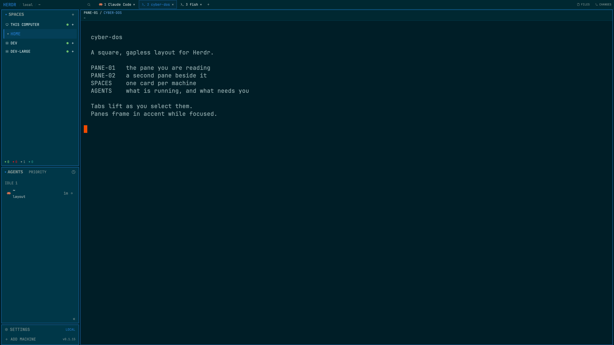

# cyber-dos

A square, gapless, two-pane workspace for [Herdr](https://herdr.dev), in a
Solarized-derived teal palette.



## What you see

A single window in three bands:

- **Top bar.** `HERDR / machine / space` on the left, a search button beside it,
  then numbered tabs as chips. The active tab lifts: rounded, a 40% accent wash,
  a shadow and a 2px accent outline. `FILES` and `CHANGES` sit at the far right.
- **Left sidebar**, three square cards flush against each other and against the
  window edge: `SPACES` (machines as headings, spaces hanging under each with a
  tree stem, git branch and ahead/behind at the row's right), `AGENTS` (grouped
  by urgency or by space), and a footer with Settings and Add machine.
- **Work area**, the active tab's panes as cards with a 6px gap. Each pane has a
  two-row header: `PANE-01 / <terminal title>` and the folder with its branch.

Every corner is square except the tab chips and the pane cards' own headers. The
palette is Solarized Dark Higher Contrast with the bright end pulled down so the
terminal's default text is not harsh.

## How it behaves

| Agent status | Where it shows |
|---|---|
| `working` | A bright green braille spinner, one turn every 1.1s, at the row's right and in the pane header |
| `blocked` | A red `NEEDS YOU` chip in the pane header and a red row marker |
| `done` | A filled dot |
| `idle` | A hollow ring |

- **Space rows** take a 20% accent wash with a 2px accent bar on the left when active.
- **Agent rows** take the same wash. The name is the conversation title (the
  terminal title, without a trailing ` | <space>`, skipping a path, a bare
  number or the program's name). Priority shows the space on the first line and
  the title under it. Grouped by space uses a space header and a square elbow;
  the row is the title, and the header has no count.
- **The spaces footer** counts agents by status: four dots and their numbers.
- **Clicking** a tab selects it; double-click renames; right-click opens a menu.
  Dragging a tab reorders. Clicking a space or agent focuses it.
- **The tab bar** shows the position, then the conversation title when the stored
  name is a bare number, an internal id, the program's own name, `codex-f`,
  `codex-z`, or `claude-grok`. Any other name stays. The strip scrolls with the
  wheel, moving between tabs.
- **Go to** (`Cmd-P` when bound to this picker) lists each installed agent under
  new tab, and starts one in the shown space.
- **The spaces and agents lists** scroll too, but their scrollbars show only
  while you scroll, so a long list keeps the sidebar clean.
- **Pressing `ctrl-shift-b`** collapses the sidebar to a 44px rail.

## Requirements

- Herdr and herdr-core installed. Built against Herdr 0.1.15.
- Git, for the Spaces panel's branch and ahead/behind columns, and for the
  Files, Changes and worktree panels.
- FiraCode Nerd Font for the intended typography. It is not bundled; Herdr falls
  back to its own fonts when it is missing.

The layout carries its own theme, fonts and terminal padding. Installing it does
not change your global `settings.json` or `keys.json`.

## Install

### Ask your agent

The shortest path. Paste this into a coding agent that can read your files
(Claude Code, Codex, Cursor and the like), with Herdr running:

```
Read ~/.config/herdr-app/AGENTS.md, then add this layout: https://github.com/drinktee/herdr-cyber-dos/tree/main
```

The agent reads Herdr's own guide, copies the layout, theme and mods into your
config, runs `herdr-app check` on each mod and switches to the layout.

### By hand

Launch Herdr once so it creates its shipped assets, and keep it running.

```sh
git clone https://github.com/drinktee/herdr-cyber-dos.git
cd herdr-cyber-dos

(
  set -e
  home="${HERDR_APP_HOME:-$HOME/.config/herdr-app}"

  test ! -e "$home/layouts/cyber-dos.json"
  test ! -e "$home/themes/cyber-dos.json"
  for mod in mods/cyber-dos-*; do
    test ! -e "$home/mods/${mod##*/}"
  done

  mkdir -p "$home/layouts" "$home/themes" "$home/mods"
  cp layouts/cyber-dos.json layouts/cyber-dos.svg "$home/layouts/"
  cp themes/cyber-dos.json "$home/themes/"
  cp -R mods/cyber-dos-* "$home/mods/"

  for mod in "$home"/mods/cyber-dos-*; do
    herdr-app check "$mod"
  done
)

herdr-app do layout.switch '{"name":"cyber-dos"}'
```

`ctrl-shift-l` cycles layouts; deleting the copied files removes the layout.

## Update

```sh
cd herdr-cyber-dos && git pull
home="${HERDR_APP_HOME:-$HOME/.config/herdr-app}"
cp layouts/cyber-dos.json layouts/cyber-dos.svg "$home/layouts/"
cp themes/cyber-dos.json "$home/themes/"
cp -R mods/cyber-dos-* "$home/mods/"
herdr-app do layout.switch '{"name":"cyber-dos"}'
herdr-app status        # no layout.error, no mod errors
```

## Files

```
layouts/cyber-dos.json    the window: blocks, sizes, theme, font, padding
layouts/cyber-dos.svg     the picture Settings shows for this layout
themes/cyber-dos.json     terminal colours and the UI colour block
mods/cyber-dos-*/         12 mods
```

The mods, by role: `workspace-chrome` (brand, corner readout, footer),
`tabs`, `spaces`, `agents`, `pane` (the pane header), `menu` (terminal
right-click), `new-menu` (the tab bar's `+`), `picker` (search), `files`,
`changes`, `machine-add`, `worktree`.

## Credits

Derived from Herdr's shipped layouts and mods, which are Apache-2.0, and from
[kyle-avrett/herdr-square-dracula](https://github.com/kyle-avrett/herdr-square-dracula),
whose square, gapless structure this layout started from. See `NOTICE`.

The palette follows Solarized (Ethan Schoonover, MIT) as used by Ghostty's
"Solarized Dark Higher Contrast" theme.

## Licence

Apache-2.0. See `LICENSE`.
