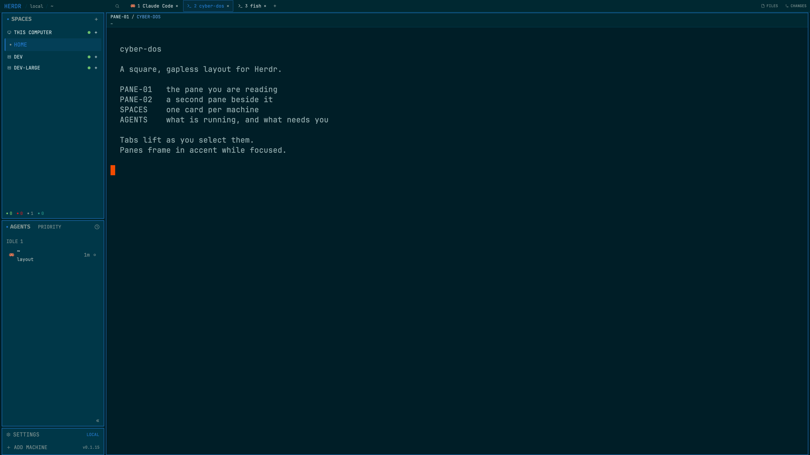

# cyber-dos — build recipe

A brief for rebuilding this layout from an empty folder. Write the files as
described; check each mod with `herdr-app check` before calling it done.



## What you see

One Herdr window, square everywhere, in a deep teal palette.

- **Top bar, 32px.** `HERDR` in accent at the left, then `/`, the active space's
  machine (`local` on this computer), `/`, and the space's name. A search glyph
  at the right of that group. The rest is the tab strip: numbered chips, the
  active one lifted. `FILES` and `CHANGES` at the far right. No title bar; the
  bar drags the window.
- **Sidebar, 300px, resizable 44–520.** Three square cards with no gap between
  them and no padding around them, each outlined 1px in accent on a `surface`
  fill: `SPACES`, `AGENTS`, and a footer of Settings and Add machine.
- **Work area.** The active tab's panes, 6px apart, each framed 1px `input` when
  unfocused and `accent` when focused, with a 34px two-row header.

## How it behaves

- Agent status: `working` a bright green braille spinner (`⠋⠙⠹…`), one turn every 1.1s,
  on the agent row and in the pane header;
  `blocked` a red `NEEDS YOU` chip; `done` a filled dot; `idle` a hollow ring.
- The active space and the focused agent take a 20% accent wash; the active tab
  takes 40% plus a 2px accent outline and a shadow.
- Machine headings are uppercase and brightest; space names keep their own case
  and step down one level; row indices step down again. Each space hangs off
  its machine's heading with a 1.5px `dim` stem, closed by a square corner on
  the last space under that machine, as agents hang off their space.
- Agent rows use the Claude session name when that process has one, otherwise
  the conversation title: the terminal title, dropping a trailing
  ` | <space>`, and skipping paths, bare numbers and the program's name. A named
  tab is the fallback. Priority shows the space name on the first line and the
  title under it. Grouped by space shows an uppercase space header with no count,
  and hangs each agent off it with a square 1.5px `dim` elbow; the row text is
  the title. Sub-agents continue that line.
- The spaces footer counts agents by status.
- The spaces and agents lists scroll; their scrollbars appear only while
  scrolling (`.mode("scrolling")`), so a long list never leaves a bar on screen.
- Tabs: click selects, double-click renames, right-click opens the menu, drag
  reorders, wheel scrolls the strip. The chip shows the position, then the
  conversation title when the stored name is a bare number, an internal id, the
  program's own name, `codex-f`, `codex-z`, `claude-grok`, or `claude-flash`. A Claude tab uses
  that process's session name when it can read one, then the window title. Any
  other name stays. The title
  is the terminal title, dropping a trailing ` | <space>`, and skipping paths,
  bare numbers and the program's name; otherwise the program's name.
- Go to lists installed agents on the shown space's machine under new tab, and
  `tab.new` starts the chosen one there.

## Built from

Layout root (`layouts/cyber-dos.json`): `type: "row"`, `theme: "cyber-dos"`,
`font: "FiraCode Nerd Font Light"`, `font_size: 18`, `ui_font: "JetBrains Mono"`,
`terminal_padding: [10, 12]`, `titlebar: "none"`, `traffic_lights: [12, 16]`,
`terminal_menu: "cyber-dos-menu"`, `preview: "layouts/cyber-dos.svg"`.

```
root (row)
├── topbar (row, 32px, window_drag)
│   ├── brand   300px  cyber-dos-workspace-chrome
│   ├── tabs            cyber-dos-tabs
│   └── readout 150px   cyber-dos-workspace-chrome {readout:true}  [hidden]
└── body (row, padding [0,4], gap 4)
    ├── sidebar (column, 300px, min 44, max 520, gap 4, padding [0,0], bg chrome)
    │   ├── spaces           weight 1, min 110, bg surface, border 1 accent
    │   ├── agents           weight 1, min 110, bg surface, border 1 accent
    │   └── sidebar-footer   64px,     bg surface, border 1 accent
    └── work (column, bg canvas)
        └── work-body (row)
            ├── main (block {tab:"active", pane:{header:{mod:"cyber-dos-pane",
            │        height:34, reveal:"always"}, background:"background",
            │        border:{1,border→input}, focus:{1,accent}, radius:0, gap:6,
            │        lone:true}})
            └── panel (column, 380px, min 260, max 900)
                └── panel-body (stack, active "changes")
                    ├── files    cyber-dos-files
                    └── changes  cyber-dos-changes
```

Mods and what each draws:

| Mod | Role |
|---|---|
| `cyber-dos-workspace-chrome` | brand bar, corner readout, sidebar footer |
| `cyber-dos-tabs` | tab chips, `+`, FILES/CHANGES toggles |
| `cyber-dos-spaces` | machine headings, space rows, git tail, footer counts |
| `cyber-dos-agents` | agent list, sub-agent tree, sort menu |
| `cyber-dos-pane` | the pane header (two rows) |
| `cyber-dos-menu` | terminal right-click menu |
| `cyber-dos-new-menu` | the `+` popup |
| `cyber-dos-picker` | the search popup |
| `cyber-dos-files` | the Files panel |
| `cyber-dos-changes` | the Changes panel |
| `cyber-dos-machine-add` | the Add machine dialog |
| `cyber-dos-worktree` | the worktree dialog |

Herdr functions used: `spaces()`, `agents()`, `panes()`, `machines()`,
`focused()`, `layout()`, `theme()`, `shared()`/`setShared()`, `run()`,
`exec()`, `hc()`, `openOverlay()`/`closeOverlay()`, `props()`,
`nextCommand()`, `updates()`, `window()`, `home()`, `setAgentOrder()`,
`watchFolder()`.

Icon assets are borrowed from Herdr's own `workspace-chrome`, `files`,
`changes` and `pane` mods by path (`mods/workspace-chrome/*.svg` and so on);
they ship with Herdr.

## Watch out

- `colors.foreground` in a layout does **not** reach the terminal's default
  text. Only `themes/<name>.json`'s `foreground` does. Put the terminal colours
  in the theme and the UI colours in the layout's `colors` block.
- `pane.index` does not exist on `PaneInfo`. Count the panes sharing a tab to
  number them (`PANE-01`, `PANE-02`).
- `FiraCode Nerd Font Light` has one weight, so `font_bold()` does nothing on
  it. Name the Regular family on text that must be bold.
- With `gap: 0` between sidebar cards their borders stack into one 2px line.
  Either leave a gap or drop one side's border.
- A pane on another machine has an address like `machine/t7`; `PaneInfo` has no
  `machine` field, so read the machine off the address when running `exec`
  there.
- The layout assumes FiraCode Nerd Font. Without it Herdr substitutes a
  fallback and the metrics shift.

## Done when

- `herdr-app check` passes for all twelve mods.
- `herdr-app do layout.switch '{"name":"cyber-dos"}'` reports ok and
  `herdr-app status` shows no layout or mod errors.
- The window shows the three cards flush against each other with no doubled
  borders, the active tab lifted, and a focused pane outlined in accent.
- A second pane shows `PANE-02` in its header.
- An agent that is working shows the braille spinner; the spaces footer counts it.
